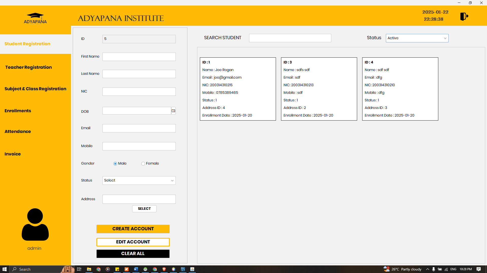
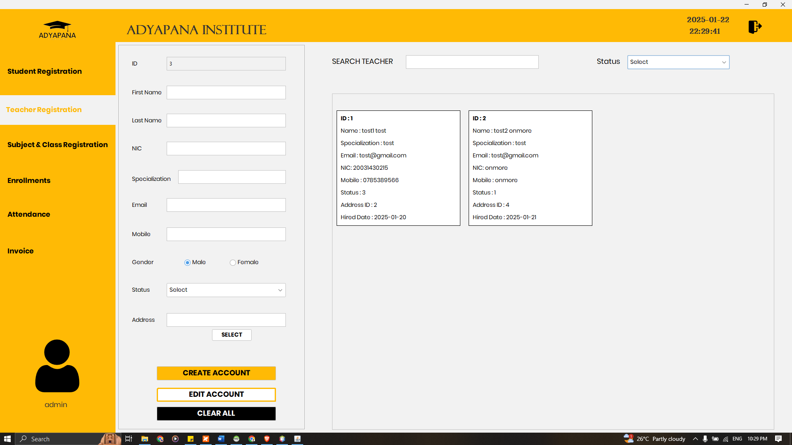
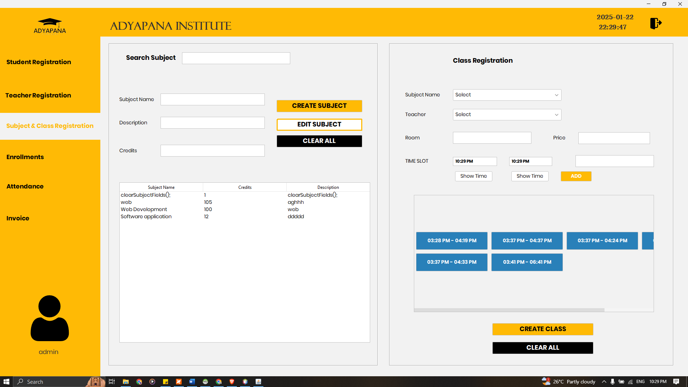
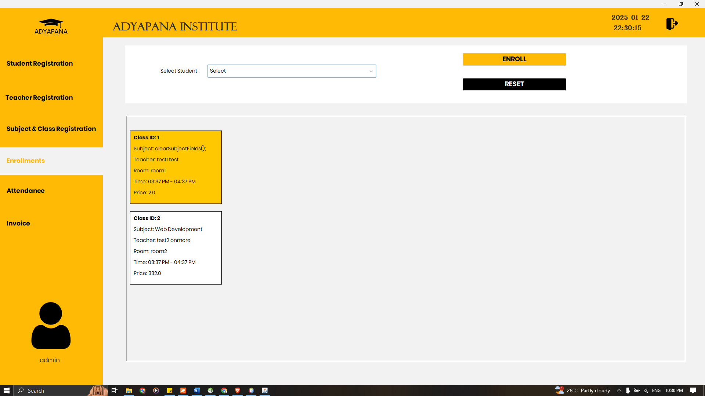
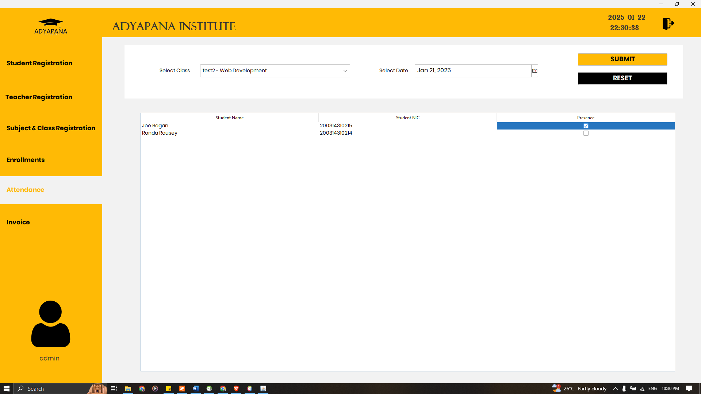
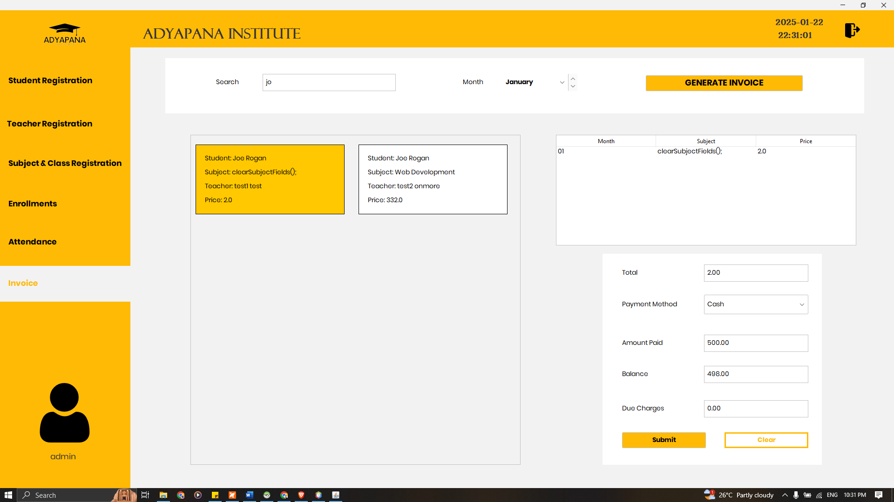

# Adyapana

**Adyapana** is a Java-based desktop application for managing core academic operations, including students, teachers, subjects, enrollment, attendance, and invoices. It provides a graphical user interface and follows a layered project structure using separate `GUI`, `Model`, and `Resources` packages.



## Overview

Adyapana is designed as an educational management system for schools, tuition institutes, or similar academic organizations. The application enables administrators to maintain academic records, manage course enrollment, record attendance, and generate invoices through a desktop GUI.

The project is developed in Java using Apache NetBeans and is organized using an object-oriented, layered design. The `GUI` package contains interface components, while the `Model` package represents application data and business logic.

## Features

- Student record management
- Teacher record management
- Subject and course management
- Student enrollment management
- Attendance tracking
- Invoice generation and management
- Graphical user interface for administrative tasks
- Modular separation of GUI, model, and resources

## Application Modules

| Module | Purpose |
|---|---|
| Student | Create, view, update, and manage student information |
| Teacher | Maintain teacher details and academic staff records |
| Subject | Manage subjects or courses offered by the institution |
| Enrollment | Record student enrollment in subjects or courses |
| Attendance | Track and manage student attendance |
| Invoice | Generate and manage payment or fee invoices |

## Screenshots

### Student Management

The Student module allows academic administrators to maintain student profiles and related records.


### Teacher Management

The Teacher module supports the management of teacher and staff information.



### Subject Management

The Subject module is used to manage subjects or courses available within the institution.



### Enrollment Management

The Enrollment module records the association between students and subjects.



### Attendance Management

The Attendance module enables recording and reviewing student attendance.



### Invoice Management

The Invoice module supports fee-related documentation and invoice handling.



## Technology Stack

| Component | Technology |
|---|---|
| Programming language | Java |
| User interface | Java Swing / AWT |
| Architecture | Layered object-oriented design |
| IDE | Apache NetBeans |
| Build tool | Apache Ant |
| Project type | Desktop application |
| License | MIT License |

## Project Structure

```text
Adyapana/
├── src/
│   ├── GUI/               # User-interface classes and forms
│   ├── Model/             # Data models and business logic
│   ├── Resources/         # Application resources
│   └── docs/              # Project screenshots and documentation assets
│       ├── Attendance.png
│       ├── Enrollment.png
│       ├── Invoice.png
│       ├── Student.png
│       ├── Subject.png
│       └── Teacher.png
├── build/                 # Compiled application output
├── nbproject/             # NetBeans project configuration
├── build.xml              # Apache Ant build script
├── manifest.mf            # Java application manifest
├── LICENSE                # MIT License
└── README.md              # Project documentation
```

## Requirements

Ensure the following are installed before building or running the project:

- Java Development Kit (JDK) 8 or later
- Apache NetBeans 12.0 or later
- Apache Ant, if building from the command line

## Installation

1. Clone the repository:

   ```bash
   git clone https://github.com/DhanikaJ/Adyapana.git
   cd Adyapana
   ```

2. Open Apache NetBeans.

3. Select **File → Open Project**.

4. Browse to the cloned `Adyapana` folder.

5. Open the project and allow NetBeans to load its configuration.

## Running the Application

### Using NetBeans

1. Open the project in Apache NetBeans.
2. Right-click the project in the **Projects** panel.
3. Select **Run**.

### Using Apache Ant

Run the following command from the project root:

```bash
ant run
```

## Building the Project

To clean and compile the project using Apache Ant:

```bash
ant clean
ant build
```

Compiled classes are generated in the `build/` directory.

## Usage

1. Launch the Adyapana application.
2. Use the main navigation interface to access the required module.
3. Add or update student, teacher, and subject records.
4. Enroll students in available subjects.
5. Record attendance for enrolled students.
6. Generate or manage invoices where required.

## System Design

Adyapana follows a layered structure:

- **GUI layer:** Handles forms, navigation, user input, and visual presentation.
- **Model layer:** Represents academic entities such as students, teachers, subjects, enrollments, attendance, and invoices.
- **Resources layer:** Stores supporting application resources.

This separation improves maintainability, scalability, and readability by keeping interface logic separate from data and business logic.

## Future Enhancements

Potential improvements include:

- Database integration for persistent data storage
- User authentication and role-based access control
- Search, filtering, and reporting features
- Exporting invoices and attendance reports to PDF or Excel
- Automated fee reminders and payment tracking
- Data validation and improved error handling
- Backup and restore functionality
- Multi-user network support

## Contributing

Contributions are welcome. To contribute:

1. Fork the repository.
2. Create a feature branch:

   ```bash
   git checkout -b feature/your-feature-name
   ```

3. Commit your changes:

   ```bash
   git commit -m "Add your feature"
   ```

4. Push the branch:

   ```bash
   git push origin feature/your-feature-name
   ```

5. Open a pull request.

## License

This project is licensed under the MIT License. See the [LICENSE](LICENSE) file for details.

## Author

**DhanikaJ**  
GitHub: [https://github.com/DhanikaJ](https://github.com/DhanikaJ)
