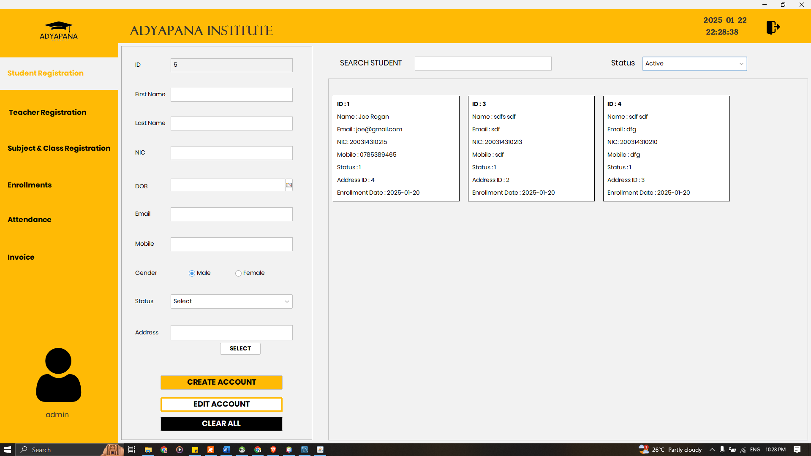
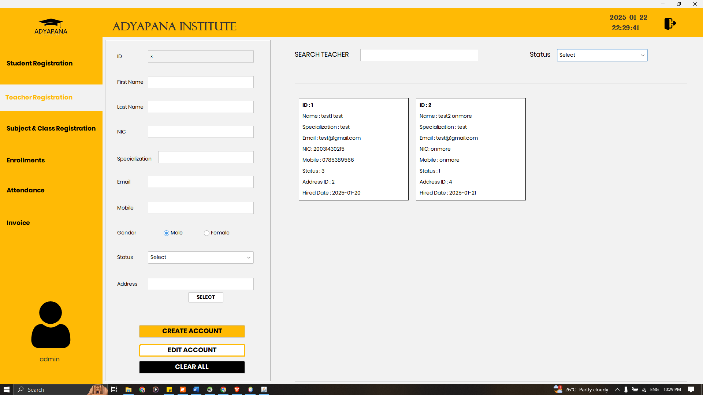
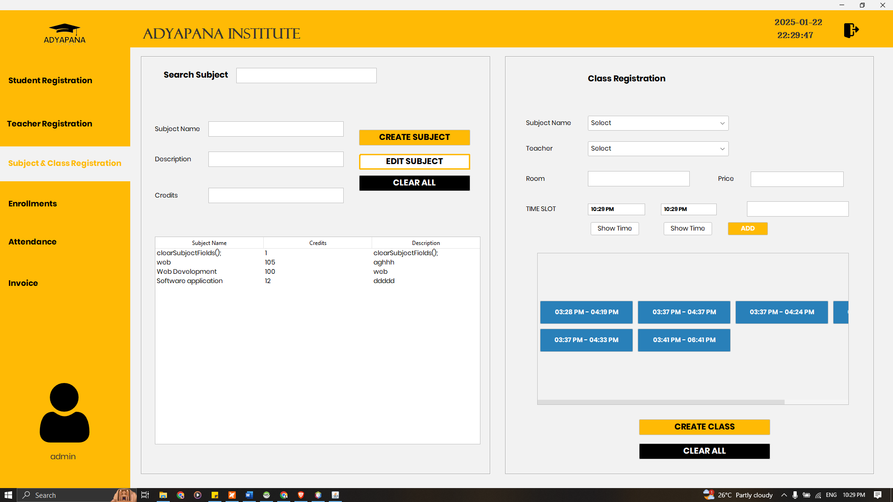
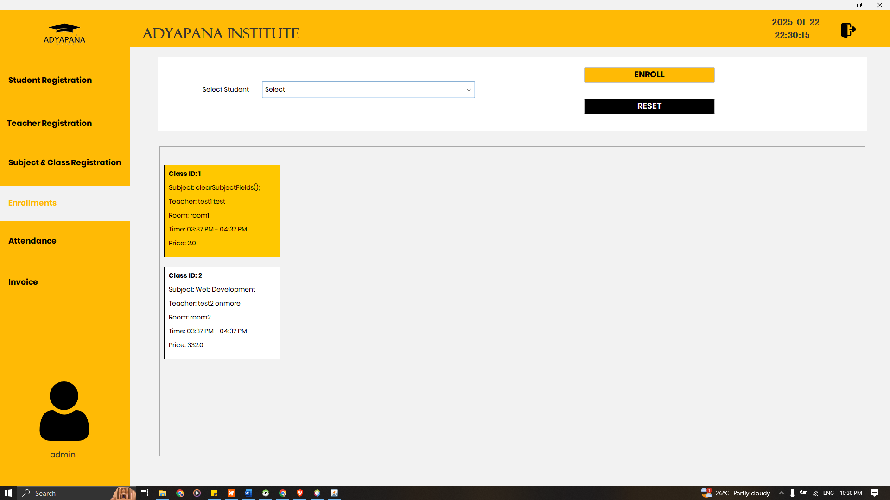
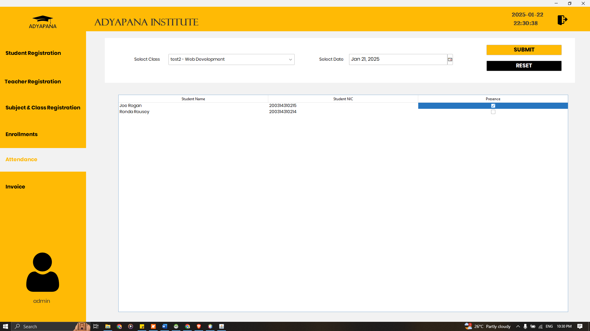
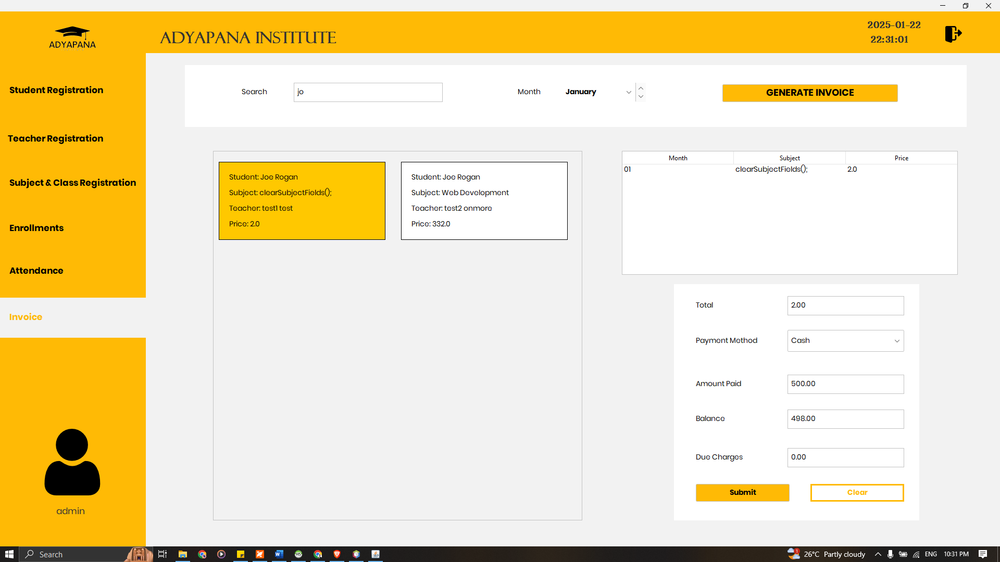

# Adyapana

**Adyapana** is a Java Swing desktop application for running a tuition institute. Staff sign in and manage students, teachers, subjects and classes, enrollments, attendance and fee payments, with all data stored in a MySQL database.



[](LICENSE)
[]()
[]()
[]()

## Overview

Adyapana was built with Apache NetBeans as a SAD module project. The interface is built with Swing and the FlatLaf look and feel. The GUI classes talk to MySQL through JDBC, using a small connection helper in `Model/MySQL.java`.

## Features

- **Staff sign-in** against a `user` table, with a logout button and a live date/time header
- **Student registration:** create and edit students (name, NIC, date of birth, email, mobile, gender, status, address), shown as searchable cards, filtered by status
- **Teacher registration:** the same flow for teachers, including a specialization field
- **Subject & class registration:** create subjects (name, description, credits), then create classes with a room, time slot, price and teacher
- **Enrollments:** enroll a selected student in classes
- **Attendance:** pick a class and a date, then mark each enrolled student present or absent
- **Invoices / payments:** search a student, add monthly class fees to an invoice, choose a payment method, and record the amount paid, balance and due amount
- **Address picker:** shared address dialog (two address lines plus a city) used by the student and teacher forms

## Application Modules

| Module (sidebar) | Purpose |
|---|---|
| Student Registration | Create, edit and search students |
| Teacher Registration | Create, edit and search teachers |
| Subject & Class Registration | Manage subjects and the classes (room, time slot, price, teacher) offered for them |
| Enrollments | Enroll students in classes |
| Attendance | Record attendance per class and date |
| Invoice | Record fee payments for a student, per month and class |

## Screenshots

### Student Registration


### Teacher Registration



### Subject & Class Registration



### Enrollments



### Attendance



### Invoice



## Technology Stack

| Component | Technology |
|---|---|
| Language | Java 21 (project source/target level 21) |
| User interface | Java Swing, with the FlatLaf look and feel |
| Database | MySQL, accessed with JDBC (MySQL Connector/J 8.4.0) |
| IDE | Apache NetBeans (GUI forms in `.form` files) |
| Build tool | Apache Ant |
| Project type | Desktop application |

### Third-party libraries

These jars are **not** stored in the repository. Download them and add them to the project classpath (NetBeans: *Project Properties → Libraries → Add JAR/Folder*):

| Library | Version | Used for |
|---|---|---|
| [FlatLaf](https://www.formdev.com/flatlaf/) | 3.4.1 | Modern look and feel |
| [MySQL Connector/J](https://dev.mysql.com/downloads/connector/j/) | 8.4.0 | JDBC driver |
| swing-toast-notifications | 1.0.4 | Toast notifications |
| JCalendar | 1.4 | Date chooser (`JDateChooser`) |
| datechooser-swing | 1.4.2 | Date picker component |
| TimingFramework | 0.55 | Animation support for the UI components |
| swing-time-picker | - | Time slot picker |
| JSVG | 1.4.0 | SVG rendering |

## Project Structure

```text
Adyapana/
├── src/
│   ├── GUI/                          # Swing screens (.java + NetBeans .form files)
│   │   ├── SignIn                    # Login screen (application entry point)
│   │   ├── SideBar                   # Main window with sidebar navigation
│   │   ├── Student, Teacher          # Registration screens
│   │   ├── SubjectnClass             # Subjects and classes
│   │   ├── Enrollment, Attendance    # Enrollment and attendance
│   │   ├── Payments                  # Invoices and payments
│   │   └── AddressView               # Address dialog
│   ├── Model/
│   │   ├── MySQL.java                # JDBC connection and query helper
│   │   └── test.config.properties.txt # Template for the database settings
│   ├── Resources/                    # Logos and icons
│   └── docs/                         # Screenshots used in this README
├── nbproject/                        # NetBeans project configuration
├── build.xml                         # Apache Ant build script
├── manifest.mf                       # Java application manifest
├── LICENSE                           # MIT license
└── README.md
```

The `GUI` classes contain both the interface and the SQL queries. `Model` currently holds only the database helper, so there is no separate business-logic layer.

## Requirements

- Java Development Kit (JDK) **21** or later
- Apache NetBeans 21 recommended (the project was created with it)
- Apache Ant, if building from the command line (NetBeans includes it)
- A running **MySQL** server (MySQL 8 recommended)
- The libraries listed [above](#third-party-libraries)

## Database setup

The application connects to a MySQL database named `adyapana`.

1. Create the database in MySQL:

   ```sql
   CREATE DATABASE adyapana;
   ```

2. Create the tables the code expects. The schema script is not included in this repository yet. The code uses these tables: `user`, `student`, `teacher`, `subject`, `class`, `time_slot`, `enrollment`, `student_has_enrollment`, `attendance`, `status`, `payment`, `payment_item`, `payment_method`, `address` and `city`.

3. Add at least one staff account to the `user` table (columns used by the login: `username`, `password`, `fName`, `lName`), plus the lookup rows the screens need (for example statuses, payment methods and cities).

4. Create the connection settings file. Copy `src/Model/test.config.properties.txt` to `src/Model/config.properties.txt` and enter your own values:

   ```properties
   db.url=jdbc:mysql://localhost:3306/adyapana
   db.username=<your MySQL user>
   db.password=<your MySQL password>
   ```

   `config.properties.txt` is listed in `.gitignore`, so your credentials are not committed. **Never commit real credentials.**

> The application reads the settings from the relative path `src/model/config.properties.txt`, so it must be started from the project root folder (NetBeans does this by default). On a case-sensitive file system (Linux, macOS) the folder name must match this exact casing.

## Installation

1. Clone the repository:

   ```bash
   git clone https://github.com/DhanikaJ/Adyapana.git
   cd Adyapana
   ```

2. Open Apache NetBeans and select **File → Open Project**, then choose the `Adyapana` folder.

3. Add the third-party jars to the project libraries. The project file still points at the author's local folder, so NetBeans will report missing libraries until you re-add them.

4. Complete the [Database setup](#database-setup).

## Running the Application

### Using NetBeans

1. Make sure the libraries are resolved and the database is running.
2. Right-click the project in the **Projects** panel and select **Run**. The main class is `GUI.SignIn`.

### Using Apache Ant

After fixing the library paths in `nbproject/project.properties`, run from the project root:

```bash
ant run
```

## Building the Project

To build a runnable JAR:

```bash
ant clean jar
```

This creates `dist/Adyapana.jar` and copies the libraries to `dist/lib/`. Because the database settings are read from `src/model/config.properties.txt`, start the JAR from the project root:

```bash
java -jar dist/Adyapana.jar
```

## Usage

1. Start the application and sign in with a staff account from the `user` table.
2. Use the sidebar to open a module.
3. Register students and teachers (use **SELECT** to pick or add an address).
4. Create subjects, then create classes for them with a room, time slot, price and teacher.
5. Enroll students in classes from **Enrollments**.
6. In **Attendance**, choose a class and a date, mark each student and press **SUBMIT**.
7. In **Invoice**, search for a student, choose the month, add the class fees, pick a payment method, enter the amount paid and press **Submit** to record the payment.

## Known Limitations

- **Security:** passwords are stored and compared as plain text, and the SQL queries are built by string concatenation, so the login and forms are vulnerable to SQL injection. This is acceptable for a classroom prototype but not for real use. Planned fix: password hashing (BCrypt) and `PreparedStatement`.
- The database schema and seed data are not included, so the project cannot run straight after cloning.
- The library jars are not bundled and the NetBeans project references local paths.
- The login screen logo is loaded from an absolute path on the author's computer, so it only appears on that machine.
- There are no user roles; every signed-in user has full access.
- A payment is saved as a student, month and class record. There is no printable or PDF invoice.
- Payments identify the class by subject name, so two classes with the same subject name can be confused.
- There is little input validation and no automated tests.
- Business logic is mixed into the GUI classes.

## Future Enhancements

- Include a database schema (`schema.sql`) and sample data
- Hash passwords and use prepared statements throughout
- Role-based access control (admin / staff)
- Printable invoices and PDF or Excel reports for attendance and payments
- Stronger input validation and clearer error handling
- Move database logic out of the GUI classes into a proper model/data-access layer
- Bundle the dependencies (for example with Maven or Gradle) and package a runnable release
- Backup and restore of the database

## Author

**DhanikaJ**  
Portfolio: [https://dhanikaj.dev](https://dhanikaj.dev)
